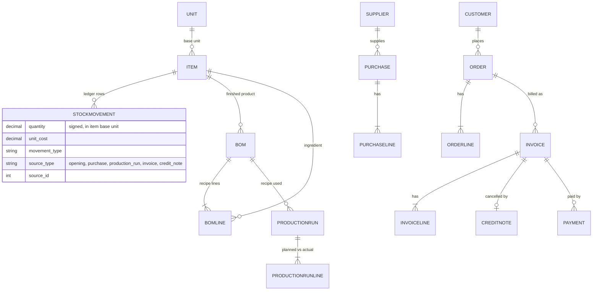

# Design note: Order-to-Audit

## 1. Data model

`Item` holds raw materials, packaging and finished goods in one table (`kind`), so one ledger works for all three.
`StockMovement.source_type` + `source_id` point back to the document that caused the movement, which gives full traceability.
`AuditLog` (user, time, action, object, detail) stands alone and is append-only.

## 2. How stock is computed

- **Ledger, not a balance column.** Every change is a new `StockMovement` row. Rows cannot be edited or deleted (the model raises an error, the admin is read-only). A balance is always `SUM(quantity)` for an item up to a date.
- **Base units.** Quantities are stored in the item's base unit (kg, litre, piece, packet). Documents may use other units; the conversion is `qty x from.to_base / to.to_base`, and only units of the same dimension convert (kg to g works, kg to litre is rejected).
- **Movement types:** OPENING (+), PURCHASE (+), PRODUCTION_ISSUE (-), WASTAGE (-), PRODUCTION_OUTPUT (+), DISPATCH (-), SALES_RETURN (+, from a credit note), ADJUSTMENT (+/-).
- The stock summary report shows opening + receipts - issues = closing for every item.
- **Atomicity.** Each business action (purchase, production run, dispatch, cancellation) runs in one database transaction. If any part fails, nothing is saved.

## 3. BOM consumption and variance

`post_production_run` does the following in one transaction:

1. Expected output = BOM yield x batches. Yield variance % = (actual - expected) / expected x 100.
2. For every BOM line: planned quantity = line quantity x batches (converted to base unit). The supervisor enters quantity issued and wastage; **actual used = issued + wastage**.
3. If stock is short for any line, the whole run is rejected.
4. Post a PRODUCTION_ISSUE and a WASTAGE movement per line, then a PRODUCTION_OUTPUT movement for the good packets.
5. Variance % per line = (actual used - planned) / planned x 100. A line or the yield is **flagged when the absolute variance is above the BOM tolerance** (3%).

Benchmark result: flour 40 vs 40 (0%), oil 10.5 vs 10 (+5%, flagged), pouches 194 vs 200 (-3%, not flagged), cartons 9 vs 10 (-10%, flagged), yield 188 vs 200 (-6%, flagged).

## 4. Costing and valuation

- **Method: weighted average cost**, replayed from the ledger in date order. A receipt with a cost updates the average; an issue leaves it unchanged. Chosen because it is simple to explain, easy to audit and smooths price changes. Flour: (100 x 42 + 60 x 45) / 160 = Rs 43.125/kg. (FIFO would price the 40 kg at Rs 1,680 instead of Rs 1,725.)
- **Material cost of a run** = sum of (actual used x average cost at the time). Damaged pouches count as used.
- **Overheads:** labour and gas/power entered per run are charged fully to that run's product (one product per run, so no apportionment is needed).
- **Cost per packet** = (materials + labour + overheads) / good packets = (4,055 + 1,200 + 600) / 188 = **Rs 31.14**; margin against Rs 50 = Rs 18.86 (37.7%).
- Finished-goods stock is valued at the latest run's cost per packet. Opening finished goods carry no cost (assumption).

## 5. GST, invoices and audit

- **Tax type:** the customer's state code is compared with the factory's (33, Tamil Nadu). Same state gives CGST + SGST, otherwise IGST. Tax is rounded to paise and SGST = tax - CGST, so the halves always add up.
- **Invoice numbers** are `FY/sequence` (e.g. 2026-27/0001), with the financial year starting in April.
- **No deletion.** A posted invoice is cancelled with a numbered **credit note** (CN/2026-27/0001) that reverses the amounts and, if the goods were dispatched, posts a SALES_RETURN stock movement. Cancellation is blocked if payments exist (refunds are not modelled).
- **Audit trail** records who did what and when, with before/after values for edits to order quantities and rates and to production costs, plus approvals, invoices, dispatches, payments and cancellations.
- **Money** uses `Decimal` rounded to 2 places. Automated tests cover stock, BOM variance, costing, GST, invoice numbering, credit notes and reports.

## 6. Extending: a second pack size

A 500 g pack needs no code change: add a packaging item "500 g pouch", a finished item "Murukku 500 g" (same HSN and GST), and a second BOM with the same ingredient lines and an expected yield of 80 packets per 40 kg batch. Orders, invoices, stock and reports follow from the master data.